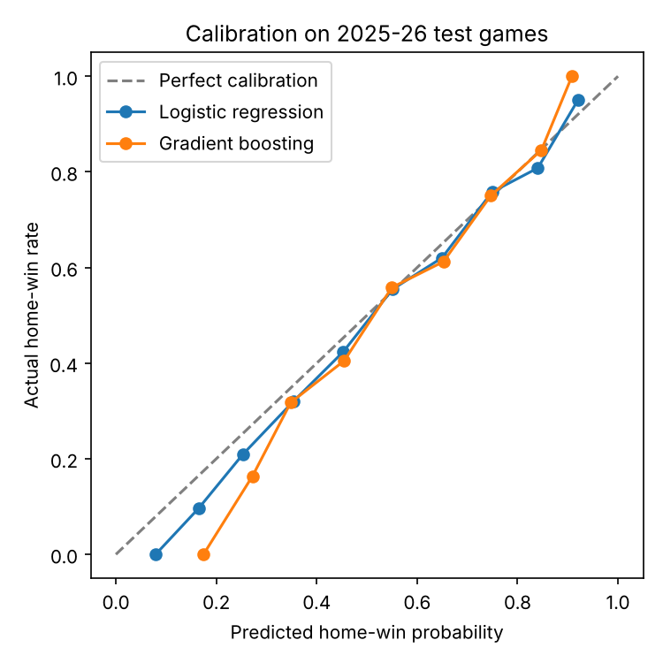

# 🏀 NBA Game Predictor

Predicts the winner of an NBA game, and the probability of that win, using only what was known before tip-off: each team's Elo rating, recent form over its last 10 games, season record, and rest.

Trained on 2015–2023, tuned on 2024, and tested on the 2025 and 2026 seasons, which the model never saw during training.

**Built by Stephen Pierre-Paul.**

## Results (2025–26 test seasons, 2,474 games)

| Model | Accuracy | Log loss | Brier score |
| --- | --- | --- | --- |
| Always pick the home team | 55.1% | 0.689 | 0.248 |
| Elo rating only | 67.1% | 0.624 | 0.215 |
| **Logistic regression** | **67.5%** | **0.603** | **0.208** |
| Gradient boosting | 67.4% | 0.609 | 0.210 |

Lower log loss and Brier score mean better probabilities, not just better picks. For reference, published NBA models and betting lines usually land around 68–70% accuracy.



When the model says the home team has a 70% chance, the home team wins about 70% of the time.

## How it works

1. **Data:** ESPN team box scores for every regular-season and playoff game, from [sportsdataverse/hoopR-nba-data](https://github.com/sportsdataverse/hoopR-nba-data).
2. **No peeking at the future:** every feature is shifted so a game's own result never feeds its prediction, and models are tested on later seasons, never a random split.
3. **Features** (home team minus away team):
   - **Elo rating:** a running strength score updated after every game, weighted by margin of victory and pulled 25% back toward average each new season
   - **Last-10-game form:** points scored and allowed, shooting percentages, rebounds, assists, turnovers, and win rate
   - **Season win percentage** and **rest** (days off, back-to-backs)
4. **Models:** logistic regression and gradient boosting (scikit-learn), compared against two simple baselines.

The strongest signal is Elo difference, followed by season win percentage and recent point differential. Playing the second night of a back-to-back hurts a team's chances.

## Run it

```bash
pip install -r requirements.txt
python src/train.py      # downloads the data, builds features, trains, writes reports/
```

## Project structure

```
src/data.py       download box scores and reshape to one row per team per game
src/features.py   Elo ratings, rolling form, rest, and the home-vs-away game table
src/train.py      time-based split, models, metrics, calibration chart
reports/          results table and charts
```

## Roadmap

- [x] Week 1: data pipeline, leak-free features, baselines, first models
- [ ] Week 2: player-level features (injuries and missing starters), hyperparameter tuning, feature importance analysis
- [ ] Week 3: Streamlit app that predicts upcoming games, and a write-up of what worked
